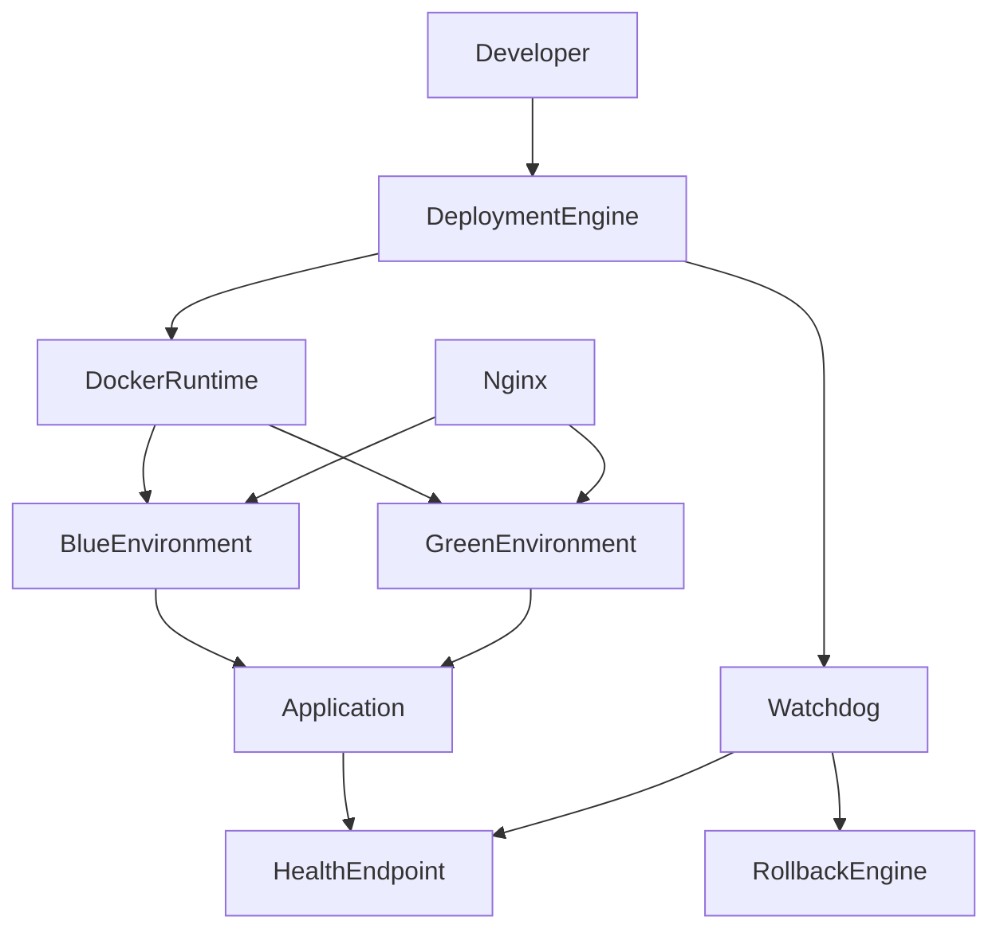
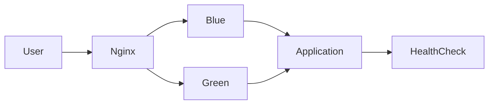
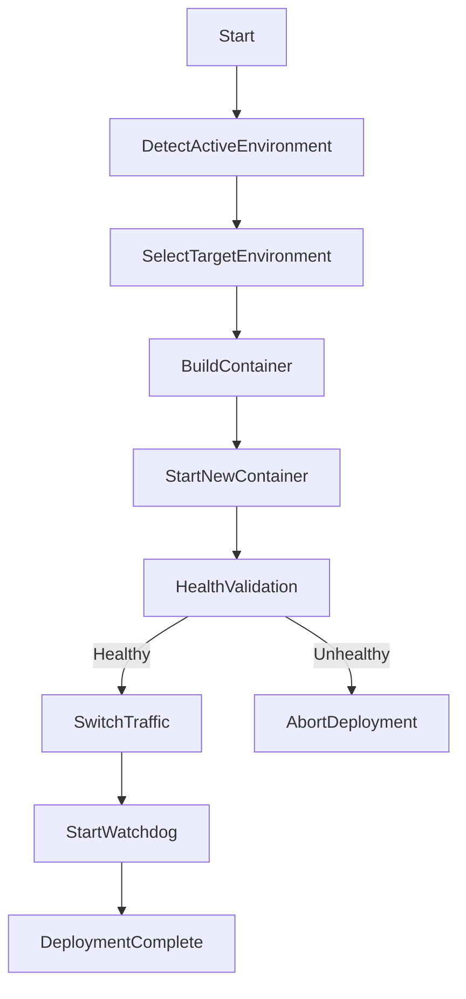
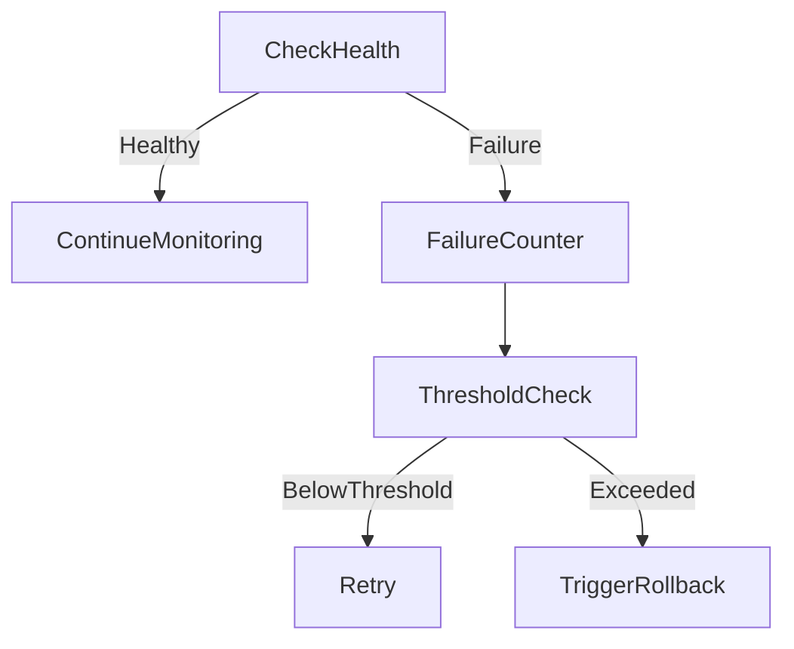

# Autonomous Self-Healing Deployment Platform

A production-style DevOps deployment platform implementing **zero-downtime releases using Blue-Green deployment strategy**, automated health validation, and an **intelligent rollback mechanism** on Linux-based infrastructure.

This project simulates how modern DevOps teams safely deploy applications while maintaining system reliability.

---

# Project Overview

Modern production systems require **safe deployments without service interruption**.  
This platform automates the deployment lifecycle while continuously monitoring application health.

Core capabilities include:

- Zero downtime deployment
- Blue-Green environment switching
- Automated health validation
- Intelligent rollback system
- Containerized application runtime
- Reverse proxy traffic routing
- Deployment monitoring and logging

---

# Architecture Overview

The platform consists of multiple infrastructure components working together to ensure reliable deployments.



---

# Blue-Green Deployment Model

The system maintains **two identical environments** to guarantee zero downtime during deployments.

| Environment | Role |
|---|---|
| Blue | Active production environment |
| Green | New deployment candidate |

Deployment process:

1. Deploy new version to inactive environment
2. Validate application health
3. Switch traffic via reverse proxy
4. Monitor deployment
5. Automatically rollback if failure occurs



---

# Deployment Workflow

The deployment engine automates the full release lifecycle.



---

# Project Structure

```
project-root
│
├── app
│   ├── application service
│   └── dashboard interface
│
├── nginx
│   └── reverse proxy configuration
│
├── scripts
│   └── deployment automation
│
├── logs
│   ├── deployment logs
│   └── watchdog logs
│
└── state
    ├── active environment state
    └── watchdog process state
```

---

# Core Components

## Application Service

A lightweight service used to simulate production deployments.

Available endpoints:

| Endpoint | Purpose |
|---|---|
| `/health` | Application health status |
| `/version` | Running application version |
| `/simulate-failure` | Simulate application failure |
| `/simulate-recovery` | Restore service health |

These endpoints allow automated validation during deployments.

---

## Reverse Proxy

The system uses **NGINX as a traffic controller**.

Responsibilities:

- Accept user requests
- Route traffic to active deployment environment
- Enable instant environment switching

---

## Deployment Engine

The deployment engine automates application release operations.

Responsibilities:

- Build application containers
- Deploy new environment
- Run health validation
- Update routing configuration
- Start monitoring services

---

## Watchdog Monitoring System

A background monitoring service continuously checks application health.

Monitoring behavior:

- Periodic health checks
- Failure detection
- Failure counter tracking
- Automated rollback trigger



---

# Self-Healing Rollback Mechanism

If repeated health failures are detected:

1. Faulty environment is stopped
2. Traffic is restored to previous environment
3. System state is updated
4. Monitoring continues

This guarantees **production stability during faulty deployments**.

---

# Deployment Example

Typical deployment lifecycle:

1. Developer triggers deployment
2. New version is deployed to inactive environment
3. Health validation is executed
4. Traffic switches to new environment
5. Monitoring watchdog observes system health
6. Automatic rollback occurs if failure is detected

---

# DevOps Practices Demonstrated

This project demonstrates several real-world DevOps engineering principles.

| Practice | Implementation |
|---|---|
| Infrastructure automation | Shell-based deployment engine |
| Containerization | Docker runtime |
| Deployment strategy | Blue-Green deployment |
| Reverse proxy routing | NGINX |
| Health validation | Application health checks |
| Self-healing systems | Watchdog monitoring |
| Observability | Deployment and monitoring logs |

---

# Future Enhancements

Potential improvements to evolve this platform into a production-grade DevOps system.

- CI/CD pipeline integration
- Kubernetes orchestration
- Canary deployments
- Prometheus monitoring
- Grafana observability dashboards
- GitHub Actions automation

---

# Skills Demonstrated

This project highlights practical DevOps engineering capabilities.

- Linux automation
- Container orchestration fundamentals
- Deployment reliability engineering
- Infrastructure management
- Reverse proxy configuration
- Monitoring and rollback strategies

---

# Author

**Ketan Ayatti**

Focused on building production-style infrastructure systems and deployment platforms.

---

# License

This project is intended for educational and portfolio demonstration purposes.
