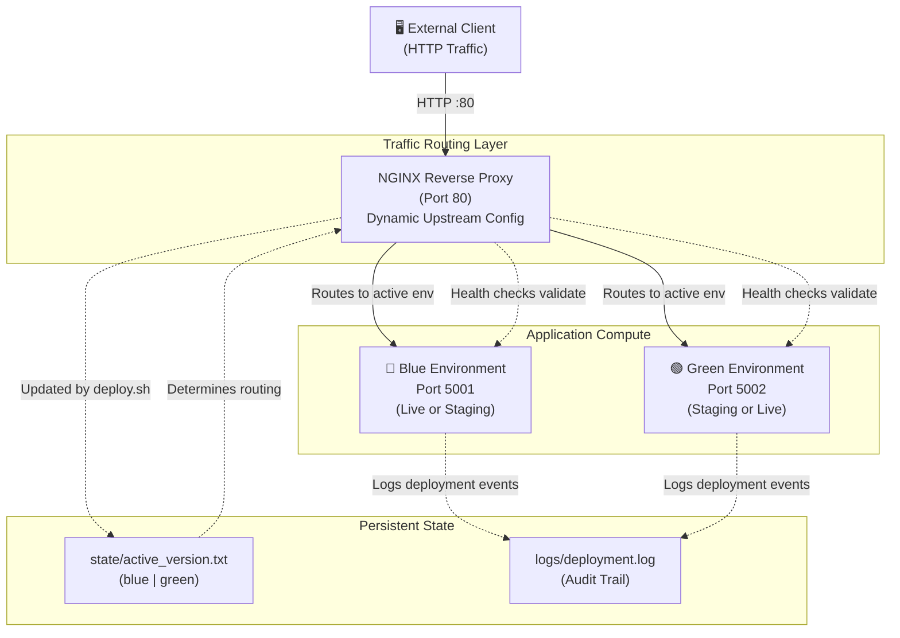

<div align="center">

```
 █████╗ ██╗   ██╗████████╗ ██████╗ ███╗   ██╗ ██████╗ ███╗   ███╗ ██████╗ ██╗   ██╗███████╗
██╔══██╗██║   ██║╚══██╔══╝██╔═══██╗████╗  ██║██╔═══██╗████╗ ████║██╔═══██╗██║   ██║██╔════╝
███████║██║   ██║   ██║   ██║   ██║██╔██╗ ██║██║   ██║██╔████╔██║██║   ██║██║   ██║███████╗
██╔══██║██║   ██║   ██║   ██║   ██║██║╚██╗██║██║   ██║██║╚██╔╝██║██║   ██║██║   ██║╚════██║
██║  ██║╚██████╔╝   ██║   ╚██████╔╝██║ ╚████║╚██████╔╝██║ ╚═╝ ██║╚██████╔╝╚██████╔╝███████║
╚═╝  ╚═╝ ╚═════╝    ╚═╝    ╚═════╝ ╚═╝  ╚═══╝ ╚═════╝ ╚═╝     ╚═╝ ╚═════╝  ╚═════╝ ╚══════╝
```

# 🚀 Autonomous Self-Healing Deployment Platform

### _Zero-Downtime Blue-Green Deployments with Intelligent Auto-Rollback_

<br/>

[](https://www.linux.org/)
[](https://www.docker.com/)
[](https://nginx.org/)
[](https://www.gnu.org/software/bash/)
[](/)
[](/)

<br/>

> **A production-grade DevOps system demonstrating modern deployment practices on Linux infrastructure.**  
> Implements zero-downtime releases, intelligent health monitoring, and automated self-healing rollback mechanisms.

<br/>

[📖 Overview](#-overview) · [🏗️ Architecture](#️-architecture) · [⚙️ Components](#️-core-components) · [🔄 Workflow](#-deployment-workflow) · [🚀 Getting Started](#-getting-started) · [🗺️ Roadmap](#️-roadmap)

</div>

---

## About

The **Autonomous Self-Healing Deployment Platform** is a containerized deployment orchestration system that eliminates operational friction through blue-green architecture, continuous health monitoring, and deterministic failure recovery. Built on lightweight Linux infrastructure with zero external dependencies (no Kubernetes, Terraform, or cloud SDKs), it serves as both a production-grade deployment engine and a fully instrumented test harness for validating CI/CD pipelines against real deployment failure scenarios.

Designed for teams that prioritize operational clarity, observability, and predictable failure handling over infrastructure complexity.

---

## 🚀 Quick Links

- **[Technical Documentation](./TECHNICAL_DOCUMENTATION.md)** — Deep architecture analysis, design rationale, performance benchmarks
- **[Getting Started](#getting-started)** — Prerequisites, setup, and first deployment
- **[Architecture Overview](#-architecture-overview)** — System design and deployment workflow

---

## ✨ Core Features

| Feature | Capability | Benefit |
|---------|-----------|---------|
| **Zero-Downtime Deployments** | Blue-green switching with atomic traffic routing | Eliminates deployment windows |
| **Automatic Health Monitoring** | External health checks with 20-second readiness window | Failed deployments never reach production |
| **Intelligent Rollback** | Deterministic failure recovery without manual intervention | Reduces operational burden and human error |
| **Chaos Testing Framework** | `/simulate-failure` and `/simulate-recovery` endpoints | Validate rollback behavior in real time |
| **Dependency-Free Orchestration** | Pure Bash scripting, no Kubernetes or external coordinators | Portable across any POSIX Linux environment |
| **Observable State Management** | File-based, human-readable deployment log and state tracking | Full audit trail and operational clarity |
| **Non-Root Container Execution** | Security hardening via appuser isolation | Reduces container escape blast radius |

---

## 📐 Architecture Overview



**Key Design Principle:** The blue environment serves live traffic. The green environment is the deployment target. NGINX dynamically routes based on `state/active_version.txt`. Failed deployments never switch traffic; previous environment remains active.

---

## 🛠️ Getting Started

### Prerequisites

- **OS:** Linux (Ubuntu 20.04 LTS or equivalent)
- **Runtime:** Docker Engine 20.10+ (with Docker daemon running)
- **Tools:** Bash 4.0+, `curl`, `sed`, standard GNU utilities
- **Ports:** 80 (NGINX), 5001 (blue), 5002 (green) must be available
- **Disk:** ≥2 GB for two container images

### Installation & Setup

```bash
# 1. Clone repository
git clone https://github.com/ketanayatti/Autonomous-Self-Healing-Deployment-Platform.git
cd Autonomous-Self-Healing-Deployment-Platform

# 2. Initialize state and logs directories
mkdir -p logs state
touch logs/deployment.log
echo "blue" > state/active_version.txt

# 3. Make deployment script executable
chmod +x scripts/deploy.sh

# 4. Pre-build base Docker image (optional, to avoid cold-start latency)
docker build -t deployment-app:v0.0.0 app/

# 5. Start NGINX reverse proxy
docker run -d --name nginx-lb -p 80:80 \
  -v $(pwd)/nginx/nginx.conf:/etc/nginx/nginx.conf \
  nginx:latest

# 6. Verify baseline connectivity
curl http://localhost/api
# Expected output:
# {
#   "message": "Deployment platform test app",
#   "version": "v0.0.0",
#   "environment": "blue"
# }
```

### Your First Deployment

```bash
# Deploy version v1.0.0 to the inactive environment (green)
./scripts/deploy.sh v1.0.0

# Watch the deployment process:
# • Docker image builds for v1.0.0
# • Container starts on port 5002 (green)
# • Health check runs (10 retries, 2-second intervals)
# • On success: traffic switches to green, state file updated
# • On failure: container stopped, traffic remains on blue (automatic rollback)

# Verify deployment result
curl http://localhost/api
# Should reflect v1.0.0 in the response
```

---

## ⚙️ Configuration Reference

### Environment Variables

| Variable | Default | Set By | Purpose |
|----------|---------|--------|---------|
| `APP_VERSION` | `v1` | Deployment script | Semantic version identifier |
| `APP_ENV` | `blue` | Deployment script | Environment slot (blue\|green) |
| `PORT` | `5000` | Dockerfile | Internal container port |
| `FAILURE_MODE` | `false` | Test harness | Simulate app failure (true\|false) |

### State File Format

**File:** `state/active_version.txt`  
**Content:** Single line: `blue` or `green`  
**Semantics:** Indicates which environment currently receives production traffic

This is the single source of truth. Both the deployment script and NGINX configuration reference this file.

---

## 🔄 Deployment Workflow

### Phase Breakdown

| Phase | Duration | Action | Outcome |
|-------|----------|--------|---------|
| **Build** | 15–30s (cold) / 2–5s (warm) | `docker build` with layer caching | Image tagged and ready |
| **Provision** | 1–2s | Container starts on idle environment | App listening on target port |
| **Health Check** | 2–20s | Retry loop polls `/health` (10×, 2s intervals) | Pass or fail after ~20s window |
| **Traffic Switch** | <1s | NGINX config updated + graceful reload | Old env remains running |
| **Total** | ~20–40s | End-to-end | Deterministic, predictable |

### Automatic Rollback Conditions

```
✅ Health check passes (HTTP 200)
   └─ Traffic switches → Deployment succeeds

❌ Health check fails (non-200 or timeout)
   └─ Container stopped → Traffic stays on old env → Automatic rollback

❌ Docker build fails
   └─ Exits early → No container starts → No traffic change

⚠️  NGINX reload fails (rare)
   └─ Manual intervention required (operational runbook in docs)
```

---

## 🧪 Chaos Testing & Failure Simulation

The platform includes built-in endpoints for validating rollback behavior:

### Simulate Failure

```bash
# Enable failure mode on active environment
curl http://localhost:5002/simulate-failure

# Response:
# {
#   "message": "Failure mode enabled – /health will now return HTTP 500",
#   "failureMode": true
# }

# Subsequent health checks now fail (HTTP 500)
curl -i http://localhost:5002/health
# HTTP/1.1 500 Internal Server Error
```

### Test Automatic Rollback

```bash
# 1. Deploy v2.0.0 successfully
./scripts/deploy.sh v2.0.0

# 2. Enable failure mode to simulate production issue
curl http://localhost:5002/simulate-failure

# 3. Trigger new deployment (will fail and rollback)
./scripts/deploy.sh v2.0.1

# 4. Verify rollback occurred
cat state/active_version.txt
# Output: blue (previous environment remains active)

# 5. Check logs
tail logs/deployment.log
# Shows deployment failure and automatic rollback
```

### Simulate Recovery

```bash
# Restore healthy state for next deployment
curl http://localhost:5002/simulate-recovery

# Response:
# {
#   "message": "Recovery complete – /health will now return HTTP 200",
#   "failureMode": false
# }
```

---

## 📊 API Reference

### Health Check

**Endpoint:** `GET /health`

**Response (Healthy):**
```json
{
  "status": "ok",
  "version": "v1.2.3"
}
```
HTTP 200

**Response (Failure Mode):**
```json
{
  "status": "failure"
}
```
HTTP 500

---

### Application Identity

**Endpoint:** `GET /api`

```json
{
  "message": "Deployment platform test app",
  "version": "v1.2.3",
  "environment": "blue"
}
```

---

### Version Metadata

**Endpoint:** `GET /version`

```json
{
  "version": "v1.2.3",
  "environment": "blue"
}
```

---

## 📈 Performance Characteristics

### Deployment Duration (Observed)

```
Cold build (first deployment):    ~35–40 seconds
Warm build (layer cache):          ~20–25 seconds
Health check window:               ~20 seconds (10 retries × 2s)
Traffic switch latency:            <100ms (NGINX graceful reload)
```

### Resource Consumption (Per Environment)

| Metric | Idle | Peak | Notes |
|--------|------|------|-------|
| **CPU** | ~50mCPU | ~200mCPU | Alpine + Node.js overhead minimal |
| **Memory** | ~90MB | ~120MB | 60MB process + 30MB buffer |
| **Disk (Image)** | ~150MB | — | node:18-alpine + Fastify + dependencies |

**Total System:** ~400MB RAM, ~300MB disk (both images)

---

<details>
<summary>🔐 Security Considerations</summary>

### Non-Root Execution
- Dockerfile creates `appuser:appgroup`; all code runs unprivileged
- Reduces container escape blast radius

### Network Isolation
- Containers communicate via Docker's internal network (`host.docker.internal`)
- **Production recommendation:** Use Docker user-defined networks with explicit iptables rules

### Secrets Management
- No credentials stored in code; all config via environment variables
- **For future:** If external services added, use HashiCorp Vault or Docker secrets

### Image Security
- Base image: Alpine (minimal attack surface, ~150MB vs ~900MB for full Node.js image)
- Dependencies: `npm ci --omit=dev` (production dependencies only)

</details>

---

<details>
<summary>🗂️ Project Structure</summary>

```
├── app/                          # Application source
│   ├── Dockerfile                # Alpine-based, non-root execution
│   ├── package.json              # Fastify 5.3.2 + @fastify/static
│   ├── server.js                 # 250 lines; HTTP routes + health checks
│   └── public/                   # Static assets
│       └── index.html            # Deployment dashboard UI
│
├── nginx/
│   └── nginx.conf                # Upstream routing (dynamically updated)
│
├── scripts/
│   └── deploy.sh                 # Main deployment automation (180 lines)
│
├── state/
│   └── active_version.txt        # "blue" or "green" (single line)
│
├── logs/
│   └── deployment.log            # Append-only deployment audit trail
│
├── TECHNICAL_DOCUMENTATION.md    # Full architecture + design docs
└── README.md                      # This file
```

</details>

---

<details>
<summary>📋 Failure Handling & Recovery</summary>

### Predictable Failure Modes

**1. Docker Build Failure**
- **Symptom:** Dockerfile syntax error, missing base image
- **Detection:** Build command exit code ≠ 0
- **Recovery:** Fix Dockerfile, re-run `./deploy.sh $VERSION`

**2. Container Startup Failure**
- **Symptom:** Node.js process crashes (memory exhaustion, uncaught exception)
- **Detection:** Container exits; health check fails after 10 retries
- **Recovery:** Check logs (`docker logs green`), fix code, rebuild

**3. Health Check Timeout**
- **Symptom:** Container runs but doesn't respond to HTTP (network/port binding issue)
- **Detection:** curl unable to connect after 20 seconds
- **Recovery:** Verify port mappings, NGINX upstream config, container network

**4. NGINX Reload Failure** (rare)
- **Symptom:** Syntax error in nginx.conf after sed injection
- **Detection:** `docker exec nginx -s reload` returns non-zero
- **Recovery:** Manual intervention required; see [TECHNICAL_DOCUMENTATION.md](./TECHNICAL_DOCUMENTATION.md)

### Disaster Recovery Runbooks

See [TECHNICAL_DOCUMENTATION.md — Disaster Recovery](./TECHNICAL_DOCUMENTATION.md#disaster-recovery) for:
- NGINX container crash recovery
- Both environments down recovery procedures
- Manual container start procedures

</details>

---

## 🤝 Contributing

Contributions are welcome. Please review our development practices:

1. **Issue reporting:** Include deployment output, error logs, and reproduction steps
2. **Pull requests:** Target `main` branch; include test validation
3. **Code style:** Follow existing Bash conventions in `scripts/deploy.sh`

For detailed contribution guidelines, see [CONTRIBUTING.md](./CONTRIBUTING.md) (if applicable).

---

## 📄 License

This project is licensed under the **MIT License**. See [LICENSE](./LICENSE) file for details.

---

## 📞 Support & Feedback

- **Issues:** [GitHub Issues](https://github.com/ketanayatti/Autonomous-Self-Healing-Deployment-Platform/issues)
- **Documentation:** [Full Technical Documentation](./TECHNICAL_DOCUMENTATION.md)
- **Author:** [ketanayatti](https://github.com/ketanayatti)

---

<div align="center">

*Production-grade deployment orchestration for teams that prioritize operational clarity and zero-downtime releases.*

**[⬆ Back to Top](#autonomous-self-healing-deployment-platform)**

</div>
